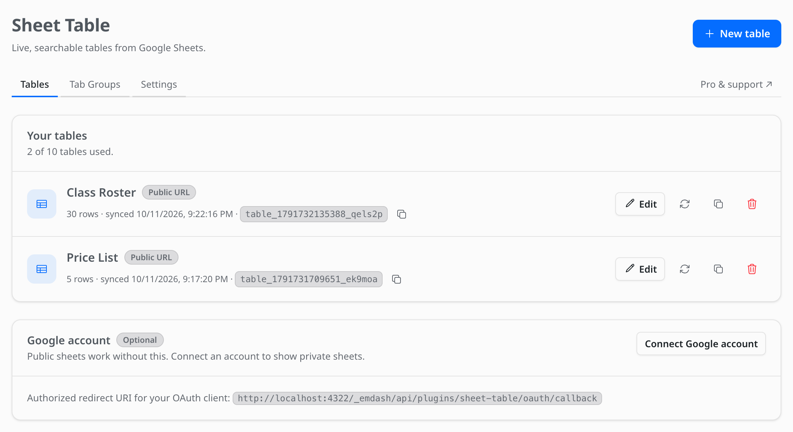

# Sheet Table user guide

How to turn a Google Sheet into a table on your EmDash site, and everything you can change about it.

## Guides

- **[Table builder](table-builder.md).** Every step of the setup wizard: data source, theme,
  customization, hiding rows and columns, and advanced settings.
- **[Themes and styles](themes.md).** The built-in themes, changing colors, building your own theme,
  and importing your sheet's formatting.

The main [README](../README.md) covers installing the plugin, private sheets, tab groups, how
syncing works, and frequently asked questions.

## Quick start

1. In Google Sheets, click **Share** and set access to **Anyone with the link can view**.
2. In the EmDash admin, open **Sheet Table** and click **New table**.
3. Name the table, paste the sheet's link, pick the tab, and click **Create table & continue**.
4. Pick a theme and any features you want, then click **Save changes**.
5. In a post or page, type `/`, insert the **Sheet Table** block and pick your table.

## What's new

The table builder adds:

| Feature | Where to find it |
| --- | --- |
| Five-step setup wizard with live desktop and phone preview | Every table's edit screen |
| 9 themes plus Auto, per-table colors, theme builder | [Table theme](table-builder.md#2-table-theme) |
| Import cell colors, fonts and alignment from the sheet | [Table theme](themes.md#import-your-sheets-formatting) |
| Merged cells | [Table theme](themes.md#merged-cells) |
| Export to CSV, Excel, PDF, JSON, Print, Copy | [Customization](table-builder.md#export-buttons) |
| Vertical scroll with sticky header | [Customization](table-builder.md#layout--scrolling) |
| Horizontal dragging | [Customization](table-builder.md#layout--scrolling) |
| Freeze columns on the left or right | [Customization](table-builder.md#layout--scrolling) |
| Default sort, hide sorting controls | [Customization](table-builder.md#sorting) |
| Five pagination styles, position and color | [Customization](table-builder.md#pagination) |
| Hide columns per device, hide rows, hide cells | [Hide rows & columns](table-builder.md#4-hide-rows--columns) |
| Custom CSS per table | [Advanced](table-builder.md#5-advanced) |
| Optimized loading | Always on, see [Advanced](table-builder.md#5-advanced) |
