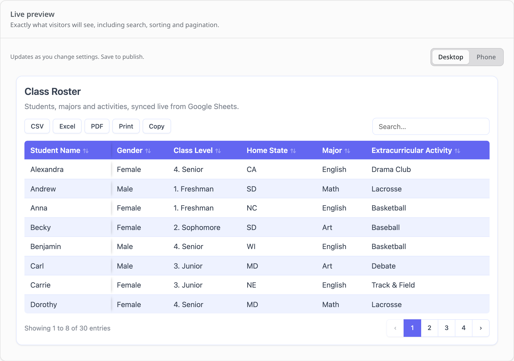
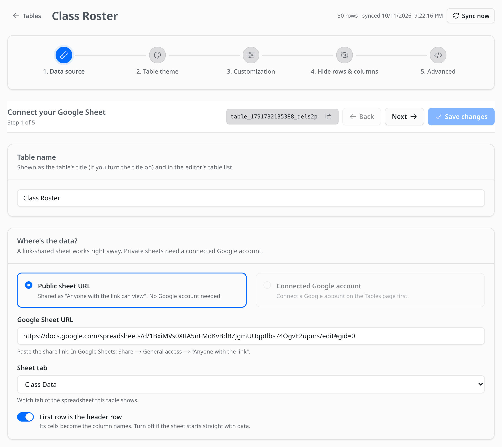
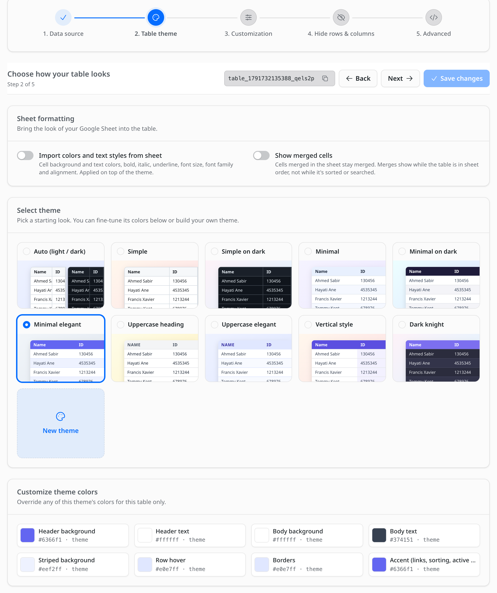
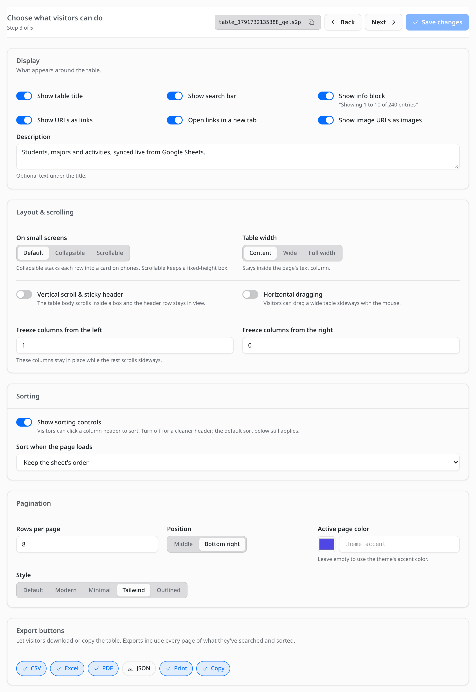
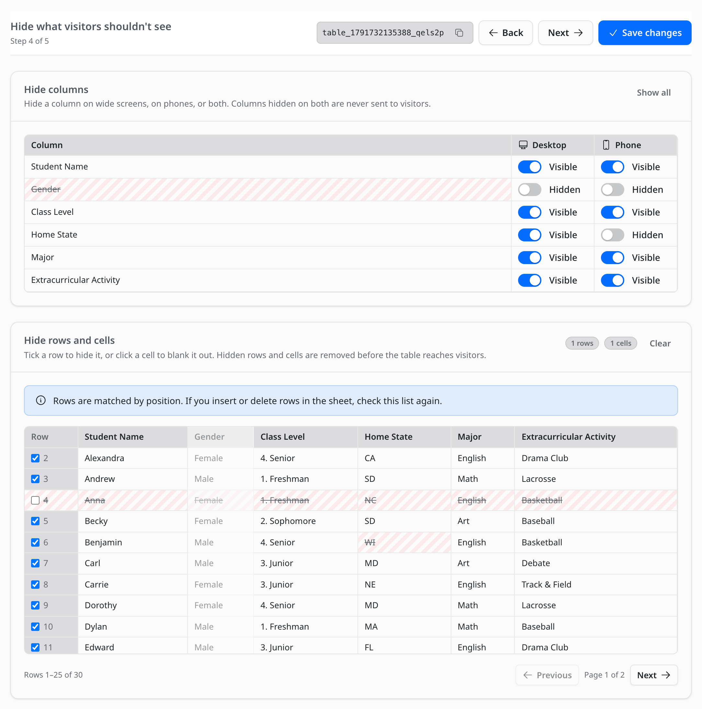

# Table builder

Every table is set up in five steps. Open **Sheet Table** in the EmDash admin and click **New table**,
or **Edit** next to an existing table.

- The step indicator at the top shows where you are. Once a table exists, click any step to jump to it.
- **Back** and **Next** move between steps without saving. **Save changes** saves everything at once.
  An *Unsaved changes* badge shows next to the table name until you save, and the browser warns you
  if you try to leave with unsaved edits.
- The **table ID** next to the buttons is what the editor blocks use. Click the copy icon to copy it.
- **Sync now** (top right) reads the sheet again right away.

A **live preview** sits under every step. It uses the same code and styles as your site, updates as
you change settings, and has a **Phone** view for checking the mobile layout. Search, sorting,
pagination and export buttons all work in the preview.



---

## 1. Data source



- **Table name.** Shown as the table's title (if you turn the title on) and in the editor's table list.
- **Public sheet URL.** For sheets shared as "Anyone with the link can view". Paste the link, and pick
  the tab from **Sheet tab**.
- **Connected Google account.** For private sheets. Pick the spreadsheet and tab from your Drive. See
  [Use private Google Sheets](../README.md#use-private-google-sheets) to connect an account.
- **First row is the header row.** Its cells become the column names. Turn it off if the sheet
  starts straight with data; the table then has no header row, so it can't be sorted.

For a new table, click **Create table & continue**. The sheet is read once so the next steps can
show a preview.

## 2. Table theme



- **Import colors and text styles from sheet** and **Show merged cells** bring your sheet's own
  formatting into the table.
- **Select theme** picks the table's look. **New theme** opens the theme builder.
- **Customize theme colors** changes colors for this table only.

All of this is covered in [Themes and styles](themes.md).

## 3. Customization



### Display

| Setting | What it does |
| --- | --- |
| Show table title | The table's name as a heading above it. |
| Show search bar | A search box that filters rows across every column. |
| Show info block | "Showing 1 to 10 of 240 entries" under the table. |
| Show URLs as links | Cells that are web addresses become clickable links. |
| Open links in a new tab | Applies to those links. |
| Show image URLs as images | Cells ending in `.png`, `.jpg`, `.gif`, `.webp`, `.avif` or `.svg` show the image. |
| Description | Optional text under the title. |

### Layout & scrolling

- **On small screens.** *Default* keeps the table and lets it scroll sideways. *Collapsible* stacks
  each row into a card on phones. *Scrollable* keeps the table in a fixed-height box.
- **Table width.** *Content* stays inside your post's text column. *Wide* grows past it up to a
  max width you set. *Full width* spans the screen.
- **Vertical scroll & sticky header.** The table body scrolls inside a box of the **Table height**
  you set, and the header row stays in view.
- **Horizontal dragging.** Visitors can drag a wide table sideways with the mouse (touch screens
  already scroll by swiping).
- **Freeze columns from the left / right.** That many columns stay in place while the rest of the
  table scrolls sideways, with a soft shadow at the edge. In the *Collapsible* layout on phones, rows
  are cards, so nothing is frozen there.

### Sorting

- **Show sorting controls.** Visitors can click a column header to sort (click again to reverse,
  a third time to go back to the sheet's order). Numbers sort as numbers, including values like
  `1,200`, `$15` or `40%`.
- **Sort when the page loads.** Pick a column and direction to sort the table before visitors touch
  it. This works even with the sorting controls turned off, for a clean header that is still in
  the order you want.

### Pagination

- **Rows per page.**
- **Position.** *Middle* centers the page buttons under the info line; *Bottom right* puts them on
  the same line, on the right.
- **Active page color.** Leave empty to use the theme's accent color.
- **Style.** *Default* (Previous / Next), *Modern* (soft pills), *Minimal* (bare numbers, current one
  underlined), *Tailwind* (one joined button group) or *Outlined*.

### Export buttons

Pick which buttons appear above the table:

| Button | What visitors get |
| --- | --- |
| CSV | A `.csv` file that opens in any spreadsheet app. |
| Excel | A real `.xlsx` workbook with a bold, frozen header row. |
| PDF | A landscape A4 PDF with the header repeated on every page. |
| JSON | A `.json` file, one object per row, keyed by the column names. |
| Print | The browser's print dialog with a clean, print-friendly table. |
| Copy | The table copied to the clipboard, ready to paste into a spreadsheet. |

Exports contain every page of what the visitor is looking at: their search and sort apply, and
columns hidden on their screen size are left out.

## 4. Hide rows & columns



- **Hide columns.** Each column has a **Desktop** and a **Phone** switch. A column hidden on both is
  removed before the table is sent to visitors. A column hidden on only one is still sent, and hidden
  with CSS on that screen size (phones are screens 640px wide or narrower).
- **Hide rows and cells.** Untick a row to hide it, or click a single cell to blank it out. Hidden
  rows and cells are removed on the server, so they are not in the page source or in exports. The
  row numbers match the row numbers in Google Sheets.
- **Show all** and **Clear** undo everything in their section.

Rows are matched by their position in the sheet. If you insert or delete rows in Google Sheets,
check this step again.

## 5. Advanced

- **Custom CSS.** Added to every page that shows the table, and to the live preview. To style only
  this table, start your rules with the selector shown under the box, for example:

  ```css
  .emdash-sheet-table[data-sheet-table-id="table_123"] th {
  	font-size: 0.8rem;
  }
  ```

  The table also reads these CSS variables, which you can set yourself: `--ft-head-bg`,
  `--ft-head-fg`, `--ft-bg`, `--ft-fg`, `--ft-stripe`, `--ft-hover`, `--ft-border`, `--ft-accent` and
  `--ft-page-active`.
- **Load asynchronously.** On: the page loads first and the table fills in right after. Off: the
  table is part of the page's HTML, so it works without JavaScript and search engines can read it.
- **Optimized loading** is always on. The table's script and styles are only included on pages that
  show a table, and the export code only downloads the first time a visitor clicks an export button.
- **Cache duration** and **Response timeout** control how often the sheet is read and how long to
  wait for Google. See [How syncing works](../README.md#how-syncing-works).
