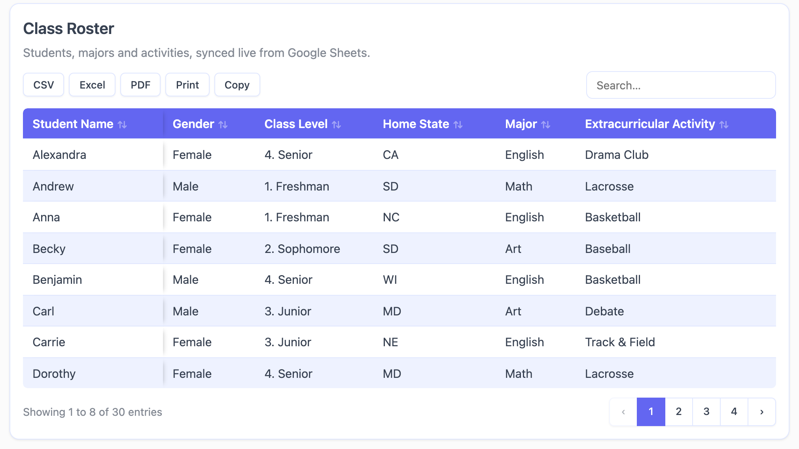
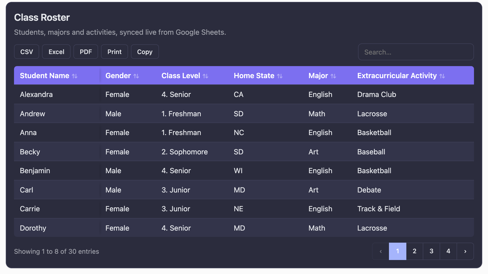
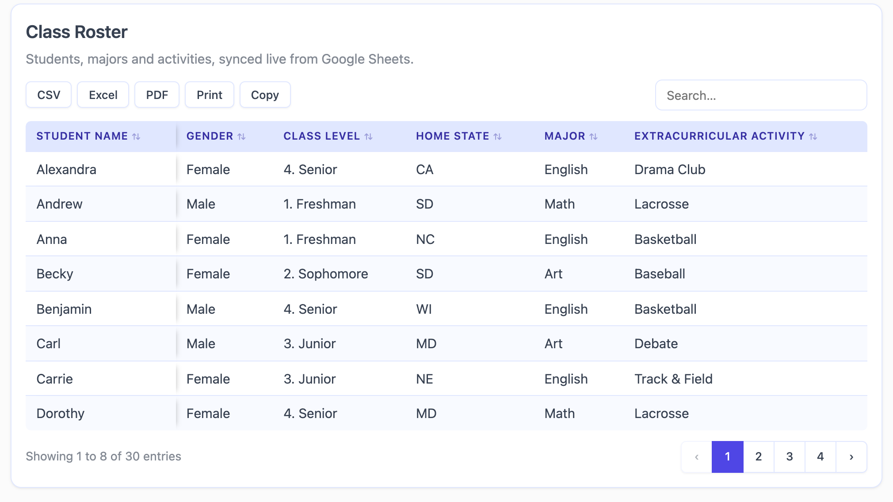
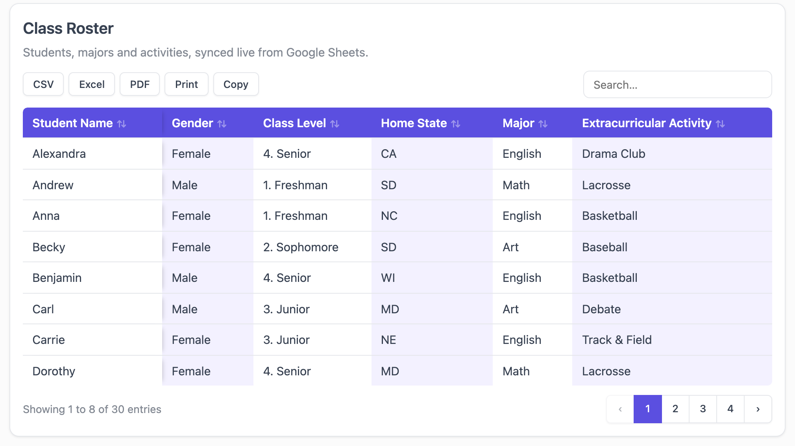
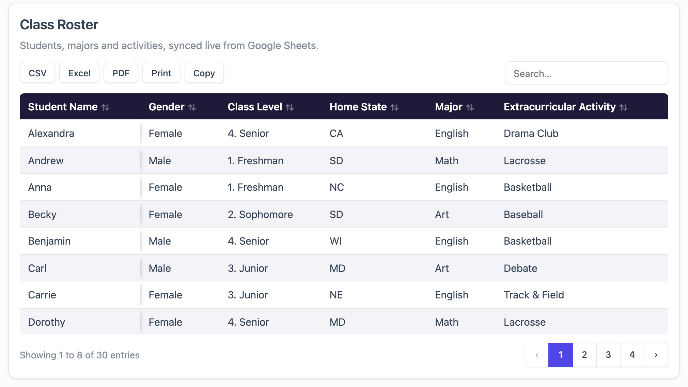
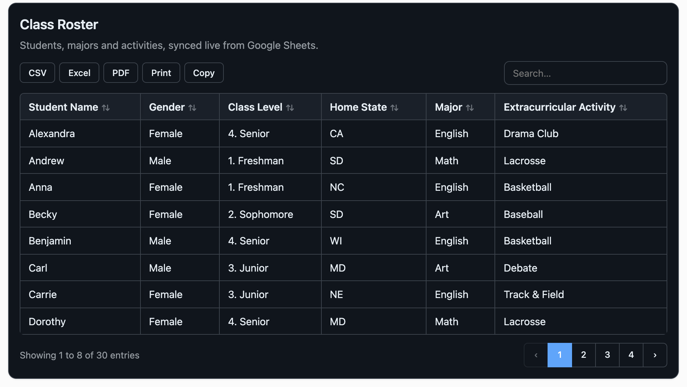
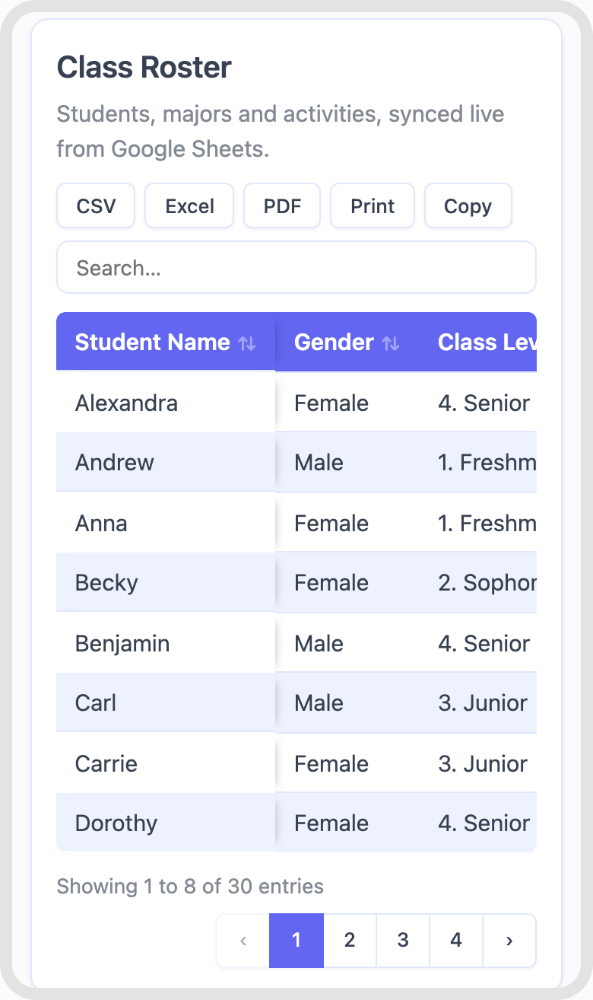
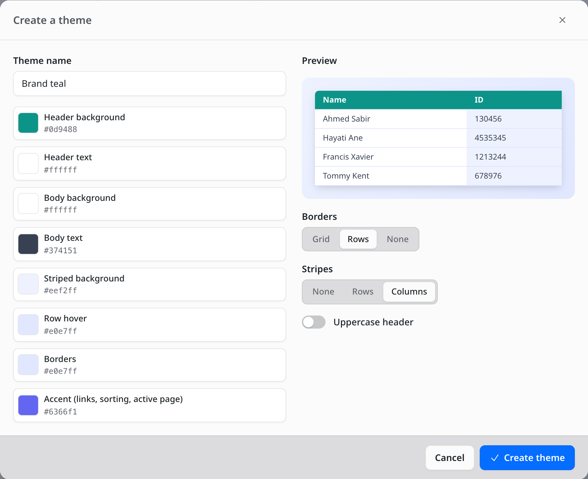

# Themes and styles

Choose a table's look in step 2 of the [table builder](table-builder.md), **Table theme**.

## Built-in themes

| Theme | Look |
| --- | --- |
| **Auto (light / dark)** | Simple, switching between light and dark with each visitor's device setting. The default. |
| **Simple** | Light, with a full grid of borders. |
| **Simple on dark** | Simple in dark colors. |
| **Minimal** | Soft blue header, lines between rows only, striped rows. |
| **Minimal on dark** | Minimal with a dark navy header. |
| **Minimal elegant** | Indigo header with white text, lavender stripes. |
| **Uppercase heading** | Small uppercase header labels on light gray. |
| **Uppercase elegant** | Uppercase header labels on soft indigo, striped rows. |
| **Vertical style** | Violet header with striped columns instead of rows. |
| **Dark knight** | Dark table body with a purple header. |

| | |
| --- | --- |
|  **Minimal elegant** |  **Dark knight** |
|  **Uppercase elegant** |  **Vertical style** |
|  **Minimal on dark** |  **Simple on dark** |

On phones, every theme works with the *Default*, *Collapsible* and *Scrollable* layouts:

## Change a theme's colors for one table

Under **Customize theme colors**, pick any of these to override the theme for this table only:

- Header background and header text
- Body background and body text
- Striped background (every other row, or column with *Vertical style*)
- Row hover
- Borders
- Accent (links, sort arrows, focus rings and the active page button)

Each color shows the theme's own value until you change it. The reset icon puts one color back;
**Reset all** puts them all back. With *Auto*, colors you set apply in both light and dark mode.

## Build your own theme

Click **New theme** at the end of the theme gallery. The theme builder starts from the theme and
colors you have now.

- **Theme name.**
- **The eight colors** listed above.
- **Borders.** *Grid* (every cell), *Rows* (lines between rows) or *None*.
- **Stripes.** *None*, *Rows* or *Columns*.
- **Uppercase header.**

Click **Create theme**. The new theme is selected for the table you're editing, and shows up in the
gallery for every other table too. Hover over a custom theme's card to **edit** or **delete** it.
Editing a theme updates every table that uses it. If you delete a theme, tables using it switch
to *Auto*.

## Import your sheet's formatting

Turn on **Import colors and text styles from sheet** and click **Save changes**. The sheet is read
again, and these come through from each cell:

- Background color and text color
- Bold, italic, underline and strikethrough
- Font size (relative to the table's text size) and font family
- Center and right alignment

Imported styles sit on top of the theme. White backgrounds and black text are left out, because
they are just Google Sheets' defaults and would hide the theme's colors. A font only shows if the
visitor's device has it; otherwise a standard sans-serif font is used.

This works for public sheets and for sheets read through a connected Google account. If the
formatting can't be read, the table still shows its data, and the Table theme step tells you why.

## Merged cells

Turn on **Show merged cells** and save. Cells merged in Google Sheets stay merged, in the header and
in the body. Merges show while the table is in the sheet's order. While a visitor is searching or
has sorted the table, merged cells are drawn as separate cells so the rows still line up. A merge
that spans two pages is cut at the page edge.
